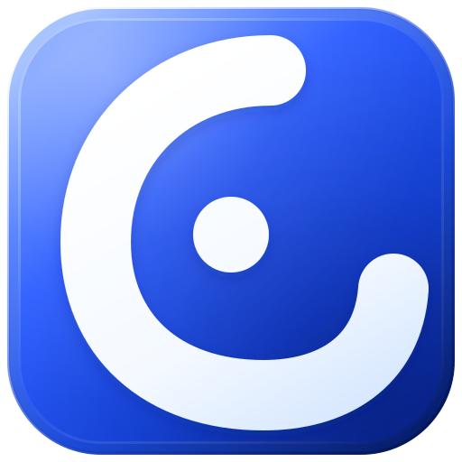
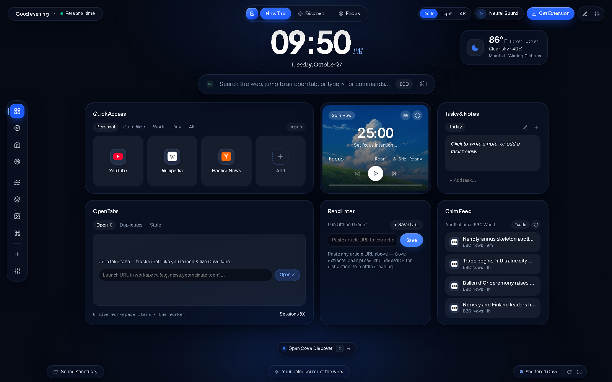
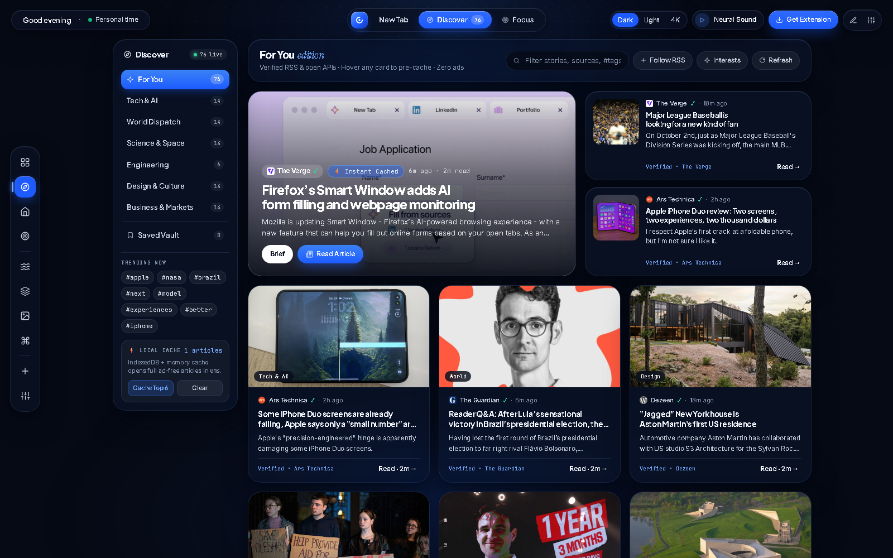
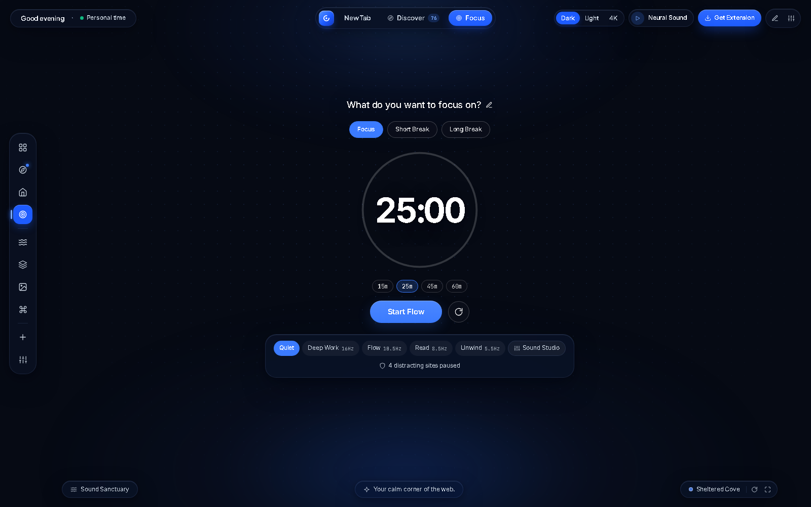
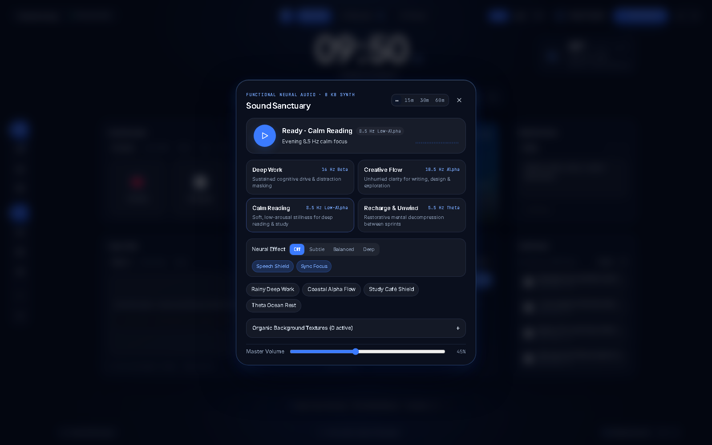
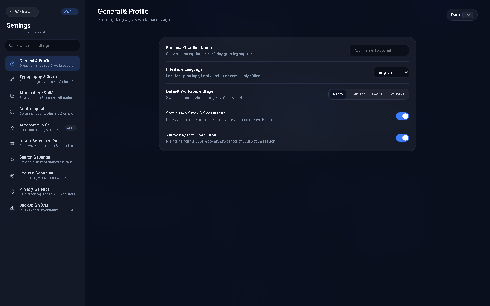
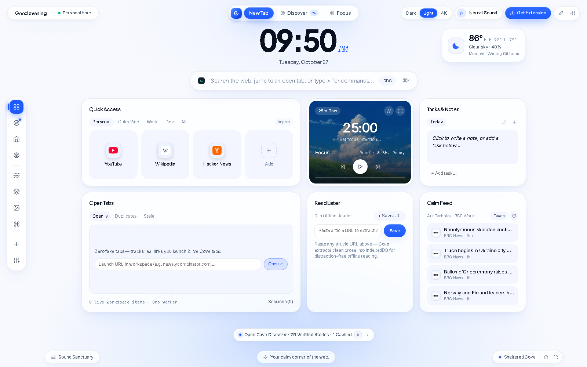
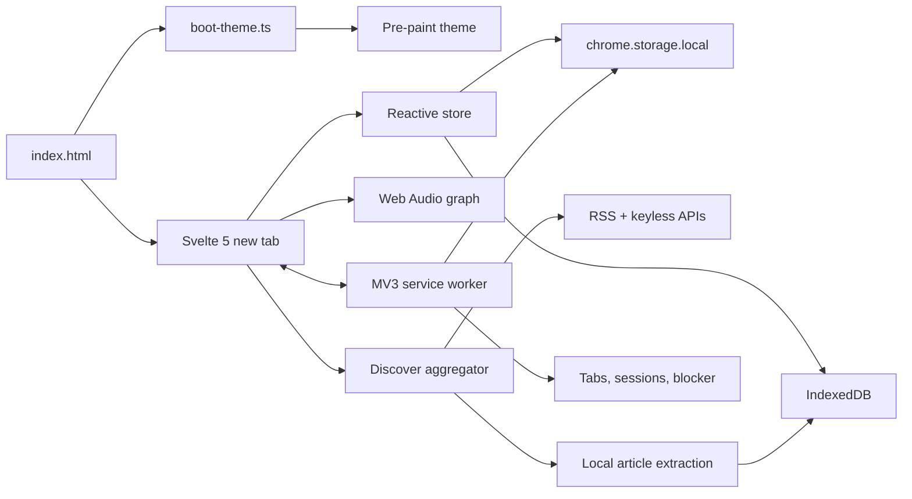

<div align="center">



# Cove

### Your calm corner of the web.

A local-first new tab for Chrome, Brave, Arc, Edge, Firefox, and Zen.  
Curated reading, an offline article reader, a tab workspace, a Pomodoro timer, and procedural focus audio — without an account or a Cove server.

[](https://github.com/DevAnimecx/cove/actions/workflows/ci-release.yml)
[](https://github.com/DevAnimecx/cove/releases/latest)
[](LICENSE)
[](docs/performance.md)
[](https://developer.chrome.com/docs/extensions/develop/migrate/what-is-mv3)
[](docs/privacy.md)

[**Website**](https://appcove.vercel.app/) · [**Install**](https://github.com/DevAnimecx/cove/releases/latest) · [**Documentation**](docs/README.md) · [**Screenshots**](#screenshots) · [**Privacy**](docs/privacy.md) · [**Security**](SECURITY.md) · [**Changelog**](CHANGELOG.md)

</div>



<div align="center">

<sub>**Cove v0.1.1** · Apache-2.0 · pre-1.0, usable today · manual install while store packaging is on the roadmap</sub>

</div>

---

## What is Cove?

**Cove is a free, open-source browser new tab that combines a quiet workspace, a local-first RSS newsroom, an offline article reader, and focus tools in one Manifest V3 extension.** It is built with Svelte 5 and TypeScript, stores its data in your browser profile, and does not require an account, a subscription, or a Cove sync service.

Most start pages are built to keep you there. Cove is built to get you where you were going: a clock, search, the handful of links you actually use, a small reading room, and a focus timer. Discover aggregates 11 curated RSS/Atom sources plus 3 keyless public APIs, ranks stories with an on-device model, and caches up to 120 full articles for offline reading.

Cove is not a cloud RSS service, does not bypass paywalls, and does not claim to be the smallest extension ever shipped. It is a deliberately constrained local tool with a documented network ledger and a 170 KB code budget.

> **Quick answer:** Cove is a calm, local-first new tab extension for Chromium and Firefox that replaces the default start page with a workspace, reader, and focus sanctuary. No account. No analytics. No Cove server. Apache-2.0.

---

## At a glance

| | |
| :--- | :--- |
| **Product** | Browser new tab / workspace / RSS reader / focus timer |
| **Status** | `v0.1.1`, pre-1.0 — every feature described here ships today |
| **Browsers** | Chrome, Brave, Arc, Edge · Firefox 128+, Zen |
| **Runtime** | **167.7 KB** gzipped JS + CSS at `v0.1.1`, enforced **170 KB** budget |
| **Data** | `chrome.storage.local` + IndexedDB; JSON export and import |
| **Privacy** | No account, no analytics, no Cove server; complete [network ledger](docs/privacy.md#network-ledger) |
| **License** | [Apache-2.0](LICENSE) — free to use, inspect, modify, and self-build |
| **Install** | [GitHub Releases](https://github.com/DevAnimecx/cove/releases/latest) — not on a store yet |

---

## Why Cove exists

Browser start pages tend to make the same trade: your first three seconds become inventory, or basic widgets become a subscription, or a reading app becomes an unread-count inbox in another tab.

Cove takes a different position:

- **One surface, local state.** The workspace, reading queue, tab sessions, and focus state share one local store. No account sprawl, no sync service, no dashboard analytics.
- **Reading is first-class, not a feed counter.** Discover shows a finite set of published sources, extracts article prose locally, and keeps cached articles readable offline.
- **Focus tools belong in the start page.** Pomodoro, a site blocker, five procedural soundscapes, and four neural-style audio modes are included — with no audio files and no subscription.
- **Small is a feature, not a slogan.** The runtime code is measured on every build. If a dependency pushes it past 170 KB gzipped, CI fails.

---

## Screenshots

| The new tab — Midnight Dark | Cove Discover — a two-pane newsroom |
| :---: | :---: |
| [](assets/screenshots/newtab-dark.png) | [](assets/screenshots/discover.png) |
| **Focus Sanctuary** | **Sound Sanctuary** |
| [](assets/screenshots/focus.png) | [](assets/screenshots/sound-sanctuary.png) |
| **Settings Studio** | **Alabaster Light** |
| [](assets/screenshots/settings-studio.png) | [](assets/screenshots/newtab-light.png) |

---

## What ships in `v0.1.1`

### A workspace, not a widget demo

- **Four spatial stages** — Bento Dashboard (`1`), Ambient Home (`2`), Focus Sanctuary (`3`), and Pure Stillness (`4`).
- **Bento widgets** — quick links, tab triage, notes, focus, read later, RSS, weather, clock, countdown, and a sandboxed embed. Resize, hide, pin, and reorder them.
- **Tab triage and sessions** — find duplicate domains, stale tabs, audible tabs, and common unread badges. Save a window as a named session without closing anything. Memory figures are clearly labelled estimates.
- **Search that answers** — bangs (`!g`, `!ddg`, `!gh`, `!yt`, `!w`, `!mdn`), arithmetic, percentages, unit conversions, world time, hex colours, and quick commands such as `focus 45`.
- **Command palette** — `Cmd/Ctrl+K` to reach tabs, sessions, notes, read-later items, stages, themes, and sound modes.

### Cove Discover

- **11 curated RSS/Atom sources** across tech, world, science, engineering, design, and business.
- **3 keyless public APIs** — Spaceflight News, DEV.to, and Hacker News Algolia. Add any custom RSS/Atom URL yourself.
- **On-device ranking** — an 18-hour freshness half-life, explicit topic choices, learned topic/source/keyword affinity, community points, unread state, and a diversity pass. Deterministic, local, and inspectable.
- **Feedback you can feel** — brief, full read, more/less like this. The profile lives in `chrome.storage.local` and is included in your backup.
- **Offline cache** — the feed plus up to 120 extracted articles in IndexedDB, with stale-while-revalidate refresh.

### A reader that respects the source

- Local article extraction strips scripts, navigation, and surrounding clutter.
- Story briefs give a summary and key points before you commit to the full read.
- Serif/sans typography, Glass/Paper/Ink surfaces, reading progress, and optional calm-reading audio.
- **No paywall bypass.** If a publisher blocks extraction or requires a login, Cove links to the original.
- Read Later saves a page from the context menu, toolbar command, or palette, and can render it offline.

### Focus without another subscription

- **Pomodoro** with configurable work/break durations, intentions, history, streaks, and daily completions.
- **Site blocker** using `declarativeNetRequest`, for focus sessions, work hours, or both. It is a friction tool, not parental control or a security boundary.
- **Five procedural textures** — rain, café room tone, velvet noise, waves, and pine wind. No audio files are bundled.
- **Four neural-style modes** — 16 Hz Deep Work, 10.5 Hz Creative Flow, 8.5 Hz Calm Reading, 5.5 Hz Recharge. A speech-band filter gently reduces nearby conversation intelligibility.
- **Not a medical device.** These are aesthetic and ergonomic tools; no clinical benefit is claimed.

### Atmosphere and control

- Eight bundled scenic wallpapers, five accent presets, and smoked dark / frosted light / system auto themes.
- Cloud, wallpaper, gradient, solid, and local-image backgrounds; dim, blur, brightness, contrast, and vignette controls.
- Four self-hosted font pairings, three UI scales, three corner profiles, and four clock faces.
- A ten-section searchable **Settings Studio**.
- Five interface languages — English, Hindi, Spanish, German, and Japanese — with English fallback.

---

## Cove compared

The comparison below is about **product categories**, not vendor checklists. Features and prices change; verify current details with each product. This is not a benchmark or a security audit.

| | **Cove** | Default browser tab | Wallpaper dashboard | Cloud RSS reader | Dedicated focus app |
| :--- | :---: | :---: | :---: | :---: | :---: |
| Account required | **No** | No | Usually no | Usually yes | Usually yes |
| Ads in the start page | **No** | Often | Plan-dependent | Plan-dependent | No |
| Local-first data | **Yes** | N/A | Mostly | No | Varies |
| RSS aggregation | **11 curated + 3 APIs + custom** | No | Rare | Yes | No |
| Offline article reader | **Up to 120 articles** | No | No | Plan-dependent | No |
| Focus timer + blocker | **Yes** | No | Sometimes | No | Yes |
| Procedural audio | **Yes, no audio files** | No | Loops or none | No | Usually loops |
| Tab triage + sessions | **Yes** | No | Rare | No | No |
| Source available | **Apache-2.0** | No | Rare | No | Rare |
| Price | **Free** | Free, ad-supported | Free + paid tiers | Free + paid tiers | Subscription |

Cove is a poor fit if you need multi-device sync today, team feed workflows, a produced music library, formal accessibility certification, or managed enterprise deployment. See the full, honest [comparison](docs/comparison.md) and [limitations](docs/features.md#honest-limitations).

---

## Install

> **Status:** `v0.1.1` is installed manually. It is not on the Chrome Web Store or Firefox Add-ons yet. Do not trust a store listing claiming to be Cove.

### Chrome, Brave, Arc, or Edge

1. Download the latest **Chrome MV3** ZIP from [GitHub Releases](https://github.com/DevAnimecx/cove/releases/latest).
2. Unzip it into a permanent folder.
3. Open `chrome://extensions` (or `brave://extensions`, `arc://extensions`, `edge://extensions`) and enable **Developer mode**.
4. Choose **Load unpacked** and select the unzipped folder.
5. Open a new tab.

### Firefox 128+ or Zen

1. Download the latest **Firefox MV3** ZIP.
2. Open `about:debugging#/runtime/this-firefox`.
3. Choose **Load Temporary Add-on** and select the ZIP or its `manifest.json`.
4. For a persistent install, use Firefox Developer Edition/Nightly via `about:addons` → **Install Add-on From File**.

### Verify a download

Release archives include SHA-256 checksums and a manifest:

```bash
sha256sum -c SHA256SUMS.txt        # macOS/Linux
Get-FileHash .\cove-chrome-mv3-v0.1.1.zip -Algorithm SHA256   # Windows PowerShell
```

Build provenance, artifact names, and rollback steps are documented in [Releasing](docs/releasing.md).

---

## Build from source

**Requirements:** Node.js `>=22.18.0` (the unit tests use `--experimental-strip-types`).

```bash
git clone https://github.com/DevAnimecx/cove.git
cd cove
npm ci
npm run dev
```

Create and verify a release build:

```bash
npm run typecheck      # strict TypeScript check
npm test               # 54 unit tests
npm run build          # Vite build + Chrome/Firefox ZIPs + checksums
npm run test:core      # 2 integration audits: MV3/CSP and no-mock UI
npm run budget         # fail at >= 170 KB gzipped
npm run verify         # validate release artifacts
```

The repository targets Node 22, uses Vite 6 and Svelte 5, and packages Chrome and Firefox variants with the same source. The [contributing guide](docs/contributing.md) covers layout, conventions, and the PR process.

---

## Architecture

Cove has no backend. The new tab is a Svelte application; a Manifest V3 service worker handles browser-level jobs; storage is split between `chrome.storage.local` and IndexedDB.



- **Pre-paint boot** applies cached theme, font, scale, corner, and language attributes from `localStorage` before the app mounts. This prevents a white flash; it is not a literal zero-millisecond startup guarantee.
- **One store, one mutation point.** `src/lib/state.svelte.ts` owns persistent state, sanitation, cache invalidation, and first-run defaults.
- **Discover has two transports.** The installed extension fetches feeds directly under host permissions; the Vite dev server provides same-origin `/api/*` middleware for local preview only. No production Cove API exists.
- **The worker stays small.** It handles context menus, commands, 15-minute session snapshots, tab activity, and blocker rules. It does not fetch news, run the smart engine, or synthesize audio.

Read the full [architecture](docs/architecture.md), [data model](docs/data-model.md), and [security model](docs/security.md).

---

## Privacy and security

Cove is **local-first, not network-silent**. The default build is a working newsroom, weather card, and favicon-rich workspace, so several network features are enabled by default. Each can be turned off.

**What never happens**

- No Cove account, no Cove sync service, no Cove analytics endpoint.
- No ad network, sponsored feed, session replay, heatmap, or A/B testing SDK.
- No Google Fonts or font CDN; all fonts are bundled.
- No remote JavaScript, remote CSS, or remote audio.
- No paywall bypass.

**What can leave your device**

| Feature | Destination | Default | Control |
| :--- | :--- | :---: | :--- |
| Discover feeds + APIs | 11 publisher feeds; Spaceflight News, DEV.to, HN Algolia | On | Settings → Privacy & Feeds |
| RSS widget | Up to 5 feed URLs | On | Settings → Privacy & Feeds |
| Weather | Open-Meteo forecast + geocoding | On | Settings → General |
| Search suggestions | DuckDuckGo autocomplete | On | Settings → Search |
| Favicons | Google / DuckDuckGo favicon services | On | Settings → Search / Appearance |
| Read-later metadata | The page you save | On | Settings → Privacy & Feeds |
| Unsplash wallpaper | `images.unsplash.com` | **Off** | Enable explicitly in Atmosphere |

Publishers and public services can see your IP address and request timing, like any web request. They do not receive a Cove identity or analytics payload. For the complete endpoint-level ledger, defaults, retention, and deletion steps, read [Privacy](docs/privacy.md).

Security reports should go through **GitHub Security Advisories**, not a public issue. See [SECURITY.md](SECURITY.md) and the [threat model](docs/security.md).

---

## Performance

Cove measures **code weight**, not total download size. At `v0.1.1`:

```text
     0.3 KB  blocked page
     3.4 KB  pre-paint theme CSS
     0.5 KB  pre-paint theme JS
   139.1 KB  new tab JS
    21.4 KB  new tab CSS
     0.9 KB  triage core
     0.6 KB  triage worker
     1.5 KB  background service worker
-----------
   167.7 KB  total gzipped JS + CSS
   170.0 KB  enforced budget
     2.3 KB  headroom
```

The budget includes every `.js` and `.css` file in `dist/`, excludes wallpapers, fonts, HTML, icons, and runtime caches, and fails CI at `170 * 1024` bytes. The full archive is larger because eight wallpapers and four font families are bundled locally.

Other deliberate choices: no runtime framework download, no third-party fonts, no audio files, local wallpapers, bounded feed/article batches, LRU eviction, and lead-story/hover prefetch. The project does **not** yet ship a reproducible cold-paint benchmark; treat paint claims as design intent until a harness exists. See [Performance](docs/performance.md) for methodology and caveats.

---

## Keyboard-first

| Shortcut | Action |
| :--- | :--- |
| `/` | Focus search (or open the palette outside Bento/Ambient) |
| `Cmd/Ctrl+K` | Command palette across tabs, sessions, notes, and commands |
| `D` | Toggle Cove Discover |
| `M` | Toggle Sound Sanctuary |
| `1` `2` `3` `4` | Bento · Ambient · Focus · Stillness |
| `,` or `Cmd/Ctrl+,` | Settings Studio |
| `Cmd/Ctrl+J` | Smart Engine studio |
| `Cmd/Ctrl+Shift+S` | Save the current window as a session |
| `Cmd/Ctrl+Shift+L` | Save the active tab to Read Later |
| `Esc` | Close the topmost surface |

The full list, search syntax, and inline commands are in [Keyboard shortcuts](docs/keyboard-shortcuts.md).

---

## FAQ

### Is Cove free and open source?

Yes. Cove is licensed under **Apache-2.0**. There is no paid tier, subscription, account, or advertising. You can read the source, build it yourself, and modify it under the license.

### Does Cove require an account or cloud sync?

No. There is no Cove account and no Cove sync service. Settings, notes, sessions, feeds, and the Smart Engine profile live in browser storage. To move data, export a JSON backup from **Settings → Data** and import it on the other device.

### Does Cove collect telemetry?

No. Cove includes no analytics, crash reporting, advertising SDK, session replay, or telemetry endpoint. It does make network requests for features such as RSS, weather, article extraction, and optional favicons; those go to the destinations listed in the [privacy ledger](docs/privacy.md#network-ledger), not to a Cove analytics service.

### Does Cove work offline?

The shell, fonts, wallpapers, notes, settings, focus timer, sound engine, and cached articles work offline. Discover shows its last cached feed, and up to 120 cached full articles remain readable. New feeds, uncached articles, weather refreshes, and optional images need a network.

### How many news sources does Discover include?

**11 curated RSS/Atom sources + 3 keyless public APIs** (Spaceflight News, DEV.to, Hacker News Algolia), plus any custom RSS/Atom feeds you add. The exact list is in [Discover](docs/discover.md#sources).

### Is the neural audio medically proven?

No. It is a procedural ambient synthesizer with adjustable modulation, not a medical device. It does not claim to treat ADHD, anxiety, sleep disorders, tinnitus, or any other condition. If you experience discomfort, stop and consult a professional.

### Is Cove on the Chrome Web Store or Firefox Add-ons?

Not in `v0.1.1`. Installation is manual from GitHub Releases. Store submission is a roadmap item, not a current claim.

More answers: [FAQ](docs/faq.md).

---

## Roadmap

**Now** — documentation and release hardening, feed compatibility, accessibility fixes, and a browser E2E harness.  
**Next** — store packaging, a smaller Discover bundle, a reproducible performance harness, and improved offline reading.  
**Later** — optional encrypted export, broader locale coverage, and a formal accessibility audit.  
**Non-goals** — engagement optimization, ad tech, cloud sync that requires an account, paywall bypass, and medical claims.

Read the detailed [roadmap](docs/roadmap.md) and [non-goals](docs/roadmap.md#non-goals).

---

## About the project

Cove is named after a sheltered edge of a larger body of water: a quiet place beside the open web, not another market square. The project is maintained by [DevAnimecx](https://github.com/DevAnimecx) and is currently pre-1.0.

The design principles are simple: keep the surface calm, keep the data local, measure what you claim, and label what is not finished. The project does not sell attention, does not run a recommendation server, and does not add a feature that only works by taking more from the user.

If Cove is useful to you, star the repository, report a specific broken feed, or contribute an accessibility fix or translation. Those are worth more than a generic “nice project.”

---

## Contributing

Contributions are welcome — especially accessibility fixes, translations, feed compatibility reports, documentation corrections, and edge-case tests. Security issues should go through [SECURITY.md](SECURITY.md), not a public issue.

```bash
npm ci
npm run dev          # local preview at http://localhost:5173
npm run release:check
```

Read [CONTRIBUTING.md](CONTRIBUTING.md), the [documentation hub](docs/README.md), and the [code of conduct](CODE_OF_CONDUCT.md) before opening a pull request.

---

## License

Copyright © 2026 DevAnimecx.

Licensed under the [Apache License, Version 2.0](LICENSE). You may use, modify, and distribute Cove under the license terms, including commercially, with notices preserved. The project does not provide a commercial support contract.

<div align="center">

**Cove** · _Your calm corner of the web._

[Website](https://appcove.vercel.app/) · [Releases](https://github.com/DevAnimecx/cove/releases) · [Issues](https://github.com/DevAnimecx/cove/issues) · [Discussions](https://github.com/DevAnimecx/cove/discussions) · [Security](SECURITY.md)

[](https://star-history.com/#DevAnimecx/cove&Date)

</div>
