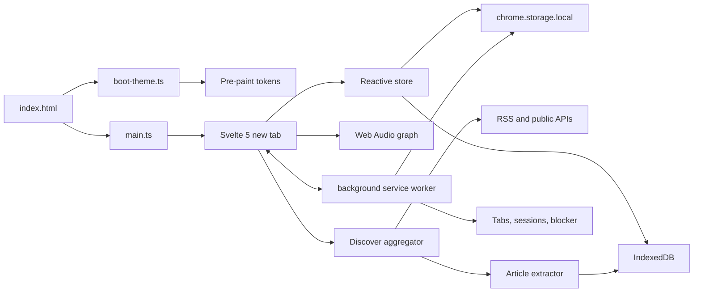
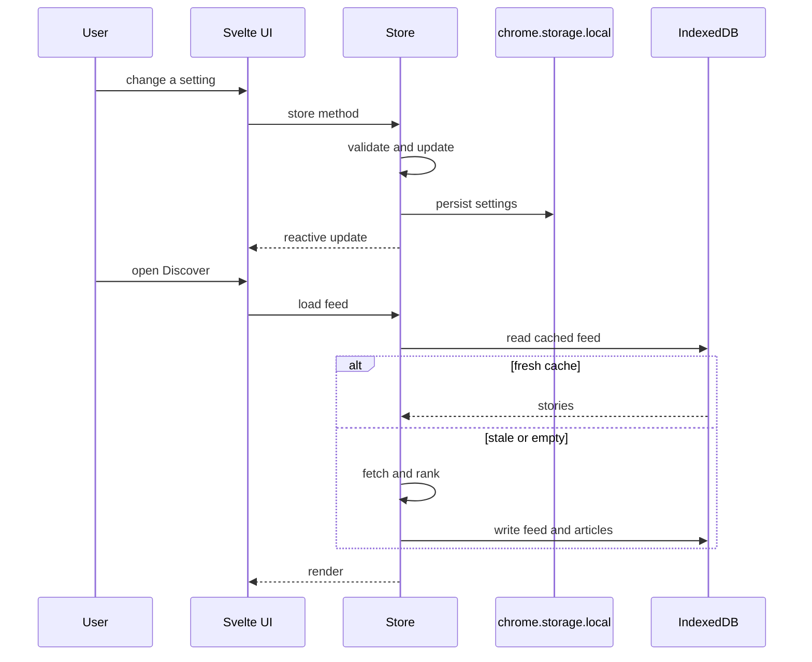

# Architecture

Cove is a single-page Manifest V3 extension with a service worker and no backend. The new tab is a Svelte 5 application; the worker handles browser-level jobs that cannot run reliably in a tab; storage is split between `chrome.storage.local` and IndexedDB.

## System at a glance

## Runtime layers

### 1. Pre-paint boot

`src/boot-theme.ts` is loaded as an external module in `index.html`. It imports the token and theme CSS, reads the `cove_fast_boot` cache from `localStorage`, and applies theme, preset, font pair, UI scale, corner style, and language to `<html>` before the Svelte app mounts.

This is the mechanism behind the "no white flash" claim. It is not a guarantee that the first frame is interactive in zero milliseconds; it means the shell does not wait for a network request or a settings read before choosing the dark appearance.

### 2. Svelte 5 application

`src/newtab/App.svelte` owns the stage router and global key handling. Feature surfaces live in `src/newtab/components/`:

- spatial stages: `HeroStage`, `FocusStage`, `WidgetGrid`, `SideDock`
- workspace: `QuickLinks`, `Notes`, `ReadLater`, `TabTriage`, `TabSessionsModal`
- reading: `DiscoverFeed`, `CoveNewsModal`
- atmosphere: `WallpaperDock`, `Weather`, `Clock`, `SoundMixerPopover`
- control: `SearchBar`, `CommandPalette`, `SettingsStudio`, `SmartEngineModal`

The store in `src/lib/state.svelte.ts` is the single mutation point for persistent state. Components read reactive values and call store methods; they do not write storage directly. This keeps sanitization, cache invalidation, and first-run defaults in one place.

### 3. Background service worker

`src/background/index.ts` registers:

- context menu: **Save to Cove Read Later**
- commands: **save session** (`Ctrl/Cmd+Shift+S`) and **read later** (`Ctrl/Cmd+Shift+L`)
- tab activity tracking for stale-tab hygiene
- a 15-minute auto-snapshot alarm, when enabled
- `declarativeNetRequest` redirect rules for the focus blocker
- message handlers for blocker sync and a five-minute pause

The worker uses `chrome.storage.local` only. It does not fetch news, run the smart engine, or synthesize audio.

### 4. Discover pipeline

The aggregation code lives in `src/lib/discover.ts` and deliberately has two transports:

| Context | Feed transport | Article transport |
| :--- | :--- | :--- |
| Installed extension | Direct `fetch` from the extension page using host permissions | Direct fetch of the source page, parsed locally |
| Local Vite dev/preview | `/api/discover`, a same-origin middleware in `vite.config.ts` | `/api/article?url=...` |
| Web preview fallback | Cached feed or custom-feed fetch | Local DOM extraction where CORS allows |

There is no Cove production API. The `/api/*` routes exist only inside the Vite dev server to make local preview reliable and are not shipped in the extension bundle.

The pipeline:

1. Fetch 11 curated RSS/Atom sources in small batches.
2. Fetch three keyless public APIs: Spaceflight News, DEV.to, and Hacker News Algolia.
3. Merge custom feeds without blocking the verified feed.
4. Deduplicate by normalized URL and title.
5. Enrich missing banners and descriptions from Open Graph metadata when possible.
6. Score and rank with recency, topic affinity, source affinity, and diversity.
7. Persist up to 90 feed stories and up to 120 full articles in IndexedDB.

See [Discover](discover.md) for the source list and ranking rules.

### 5. Article extraction

`src/lib/reader.ts` contains a dependency-free `DOMParser` extractor for read-later items. `src/lib/discover.ts` contains the richer newsroom extractor used by Cove News: it removes scripts, navigation, forms, iframes, and other chrome, keeps headings and prose, sanitizes text by escaping, and caches the cleaned article.

The extractor is intentionally conservative. It does not execute publisher scripts, does not embed remote frames, and does not attempt to bypass paywalls. If an article cannot be extracted, Cove shows the feed summary and a link to the original.

### 6. Neural audio

`src/lib/audio.ts` builds the entire soundscape with the Web Audio API. There are no audio files to download. Oscillators, filters, noise buffers, gains, and an analyser are created on demand and torn down when the mode changes.

The graph has three layers:

- a polyphonic harmonic pad,
- phase-locking modulation applied to amplitude and filter cutoff,
- procedural nature/room textures plus a gentle speech-band shaping filter.

The analyser feeds the live visualizer. Audio starts only after a user gesture, as required by browser autoplay policy. See [Neural audio](neural-audio.md).

### 7. Smart engine

`src/lib/smart-engine.ts` is a pure decision layer. It records typed signals, updates a circadian model, maintains first- and second-order Markov transitions, applies a 14-day half-life decay, and produces ranked suggestions. `state.svelte.ts` decides whether to apply a suggestion based on the autonomy mode.

No signal content or derived profile leaves the device. The memory object is included in the JSON backup so a user can inspect or migrate it.

## Data flow

## Storage boundaries

| Store | Used for | Why |
| :--- | :--- | :--- |
| `localStorage` | `cove_fast_boot` only | Synchronous read before first paint |
| `chrome.storage.local` | settings, lists, smart memory, caches, blocker state | Extension-safe persistence with async access |
| IndexedDB `cove_local_db` | read-later queue, local wallpaper blob | Larger structured data and binary images |
| IndexedDB `cove_news_cache_v1` | feed cache, full-article LRU | Quota-friendly article HTML |

When the extension runs as a plain web page, `src/lib/storage.ts` falls back to `localStorage` under the `cove:` prefix. This fallback exists for development and preview, not for a hosted Cove account.

## Trust boundaries

1. **Extension page to web content.** Feed and article HTML is untrusted. It is parsed with `DOMParser`, stripped of active elements, and re-emitted as escaped text.
2. **Extension page to browser APIs.** `chrome.tabs`, `chrome.sessions`, `chrome.bookmarks`, and `declarativeNetRequest` are privileged. They are used only for explicit workspace features and the configured blocker.
3. **Extension page to network.** Any request can reveal the user's IP and request timing to the destination. Cove minimizes requests, makes optional ones opt-in, and lists every destination.
4. **Backup import.** Imported JSON is hostile until validated. `src/lib/validation.ts` bounds array sizes, checks URL schemes, clamps numbers, and rebuilds settings over safe defaults.

See [Security](security.md) for the full threat model.

## Failure modes

| Failure | Behaviour |
| :--- | :--- |
| Offline | Cached feed and saved articles remain readable; weather shows its last cache or hides; fonts, wallpapers, and audio still work |
| Feed CORS failure | The source is skipped; other sources still render |
| IndexedDB unavailable | The app falls back to in-memory data for the session and reports reduced caching |
| Storage quota exceeded | Cache writes are ignored, never fatal; settings writes surface an error |
| Malformed RSS | The parser skips invalid entries; it does not inject markup |
| Missing favicon | A generated brand mark or monogram is used |
| Blocked page | `blocked.html` explains the block and offers a five-minute pause |
| Firefox API gap | Unsupported calls are feature-detected; the core new tab still works |

## Build and packaging

`vite.config.ts` produces three entries: `newtab`, `blocked`, and `background`. `scripts/package-extensions.mjs` copies the Chrome and Firefox manifests, creates deterministic archives, writes `SHA256SUMS.txt` and `release-manifest.json`, and keeps `unpacked-chrome-mv3/` in sync for manual loading. `scripts/check-budget.mjs` enforces the code budget. `scripts/verify-release.mjs` checks the packaged output.

## Design constraints

- No runtime dependency on a Cove server.
- No remote code, inline script, or `eval`.
- No content script that reads arbitrary pages in the background.
- No analytics SDK, A/B testing service, or crash reporter.
- The extension must remain useful with the network disconnected.

## Related reading

- [Data model](data-model.md)
- [Discover](discover.md)
- [Performance](performance.md)
- [Privacy](privacy.md)
- [Security](security.md)
- [Testing](testing.md)
