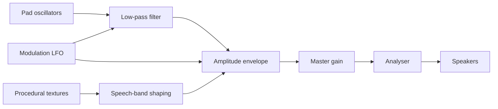

# Focus Sound

Cove's sound engine is a procedural Web Audio synthesizer. It ships no audio files, downloads no loops, and makes no network requests. The result is a small, adjustable soundscape that can run offline.

Focus Sound is an aesthetic and ergonomic tool, not a medical claim. Cove is not a clinical device and does not promise entrainment, treatment, or a specific cognitive outcome.

## Signal chain

- **Pad**: four detuned oscillators tuned to an open chord voicing. Slow attack and release avoid clicks.
- **Modulation**: a low-frequency oscillator moves filter cutoff and amplitude together. The rate and depth are tuned per mode.
- **Textures**: filtered noise and shaped resonance create rain, room tone, velvet noise, waves, and wind.
- **Speech shield**: a gentle peaking filter around the speech band reduces the intelligibility of nearby conversation without claiming to remove it.
- **Analyser**: real spectrum data drives the visualizer. It is not a decorative animation.

## Modes

| Mode | Chord | Character |
| :--- | :--- | :--- |
| Deep Work | D2, A2, E3, A3 | Open suspended voicing, steady pulse, rain and velvet noise |
| Creative Flow | C2, G2, D3, E3 | Warm major ninth, waves, café, wind |
| Calm Reading | F2, C3, G3, A3 | Soft low-arousal pad, rain, quiet noise, wind |
| Recharge & Unwind | A1, E2, B2, C#3 | Deep, slow, wave-forward |

Depth settings scale amplitude modulation and filter movement:

- Subtle: minimal movement.
- Balanced: default.
- High: more pronounced movement.

Higher depth is not "better"; it is more noticeable. Users who are sensitive to pulsing should use Subtle or turn Focus Sound off.

## Soundscapes

The mixer blends five textures independently:

- rain,
- café room tone,
- white/velvet noise,
- waves,
- pine wind.

Each layer has its own gain and lifecycle. Switching modes fades layers rather than cutting them abruptly. All audio stops when the user stops the sound or closes the tab.

## Audio safety

- Audio starts only after a user gesture, respecting browser autoplay policy.
- Master volume is user-controlled.
- There is no hidden autoplay, ultrasonic carrier, or ultrasonic content.
- The synthesizer uses audible-range oscillators and filtered noise.
- The speech shield is a gentle EQ curve, not an active noise-cancellation system.
- Stop all sounds is always available from the mixer and focus stage.

If you experience discomfort, dizziness, tinnitus, or headache, stop using the audio and consult a qualified professional. Do not use the sound engine while driving or operating machinery.

## Performance

- No sample decoding, no audio network requests, and no large buffers.
- Noise buffers are generated once per audio context.
- Oscillators and gains are torn down when a mode changes or audio stops.
- The analyser reads a byte frequency array only while the visualizer is visible.

The engine is deliberately small enough to fit inside the 170 KB code budget. If you add a new mode, measure the bundle and test cleanup.

## Adding a mode

1. Add the ID to `NeuralModeId` in `src/lib/types.ts`.
2. Add a spec to `NEURAL_MODES` with a label, band, frequency, chord, cutoff, spatial rate, and recommended mix.
3. Add UI copy and a command-palette entry.
4. Add a cleanup path if the graph needs new nodes.
5. Test on headphones and speakers at low and high volume.
6. Update this page.
7. Do not add a medical claim without evidence and review.

## What this is not

- Not binaural beats delivered as two separate stereo tones.
- Not a clinical anxiety, ADHD, sleep, or tinnitus treatment.
- Not a replacement for silence, breaks, or professional care.
- Not a guarantee that a frequency produces a mental state.

The honest description is: a carefully designed, locally synthesized ambient focus tool with adjustable modulation and no clinical claims.

## Related reading

- [Features](features.md)
- [Design system](design-system.md)
- [Performance](performance.md)
- [FAQ](faq.md)
